# Information Architecture — CMT Dashboard

**Status**: Reconciled with code — 2026-09-22 (routes verified against `src/app/main.py`)
**Derives from**: `docs/srs.md`, `PRD.md` §1.3 (as-built drift record)
**Note**: The 2026-08 version of this document described `/imports`, `/exports`, `/vessels`
pages and no user management. Those routes no longer exist; the live route set is below.

## 1. Site Map

```mermaid
graph TD
    subgraph "Public (No Auth)"
        A[GET /login] --> B{POST /login}
        H[GET /api/health]
        L[POST /set-lang]
        D[POST /set-db]
    end

    subgraph "Authenticated - require_login"
        B --> C[GET /  Dashboard]
        C --> E[GET /shipments]
        C --> I[GET /invoices]
        C --> K[GET /ledger]
        C --> M[GET /sales]
        E --> E2[GET /shipments/detail]
        I --> I2[GET /invoices/detail]
        K --> K2[GET /ledger/detail]
        C --> S1[GET /api/summary]
        C --> S2[GET /api/sync-status]
        C --> LO{POST /logout}
    end

    subgraph "management+ - require_role"
        C --> J{POST /sync}
    end

    subgraph "admin+ - require_role"
        C --> U[GET /users]
        U --> U1[POST /users/new]
        U --> U2[GET+POST /users/:id/edit]
    end

    subgraph "superadmin - require_role"
        C --> Q[GET /data-quality]
        Q --> Q2[GET /data-quality/detail]
        U --> U3[POST /users/:id/delete]
    end

    style A fill:#333,stroke:#888,stroke-width:2px
    style B fill:#333,stroke:#888,stroke-width:2px
    style H fill:#333,stroke:#888,stroke-width:2px
    style L fill:#333,stroke:#888,stroke-width:2px
    style D fill:#333,stroke:#888,stroke-width:2px
```

## 2. Page Inventory

| Route | Template | Guard | Description |
|---|---|---|---|
| `GET /login` | `login.html` | public | Authentication screen. |
| `POST /login` | — | public | Validates credentials against `users` table; sets `cmt_session` cookie (HttpOnly, SameSite=Lax, `Secure` behind TLS). |
| `POST /logout` | — | `get_current_user` | Invalidates server-side session, clears cookie, redirects to login. |
| `GET /` | `index.html` | `require_login` | Dashboard: summary stats, unpaid-shipments table, Top Customers (hidden for `customer` role). Customer-filtered. |
| `GET /shipments` | `shipments.html` | `require_login` | Unified shipment list. Filters: `q` search, `sort`/`dir`, `type` (`I` imports / `E` exports / other), `invoice` link. Customer-filtered. |
| `GET /shipments/detail` | `shipment_detail.html` | `require_login` | One shipment: header (ETD/ETA/ATA, vessel, agent, shipper/consignee), OPR costs, invoices, DR/CN notes. Not company-filtered (see §5). |
| `GET /invoices` | `invoices.html` | `require_login` | Invoice list with status filters (Un-issued, Issued, Paid, Issued & Unpaid) and shipper name resolution. Customer-filtered. |
| `GET /invoices/detail` | `invoice_detail.html` | `require_login` | Line items grouped by `K_INVOICE`, payment summary, EXRATE-converted totals. Not company-filtered (see §5). |
| `GET /ledger` | `general_ledger.html` | `require_login` | Chart of accounts; `type` filter (`D` detail / `G` group), search, sort. No company filter by design. |
| `GET /ledger/detail` | `ledger_detail.html` | `require_login` | Journal entries (`JE_D`/`JE`) for one account, date range + sort, newest-first default. |
| `GET /sales` | `sales.html` | `require_login` | Sales Dashboard: summary, monthly trend, Top Customers, Top Salesman (`p=month/year/round/all`). Customer-filtered. |
| `GET /data-quality` | `data_quality.html` | `require_role("superadmin")` | GL anomaly rollup (unbalanced / orphan / bad_date / bad_dk), scoped to the active company DB. |
| `GET /data-quality/detail` | `data_quality_detail.html` | `require_role("superadmin")` | Paginated rows for one anomaly type; invalid types redirect back. |
| `GET /users` | `users.html` | `require_role("admin")` | User list + create form. |
| `POST /users/new` | — | `require_role("admin")` | Create user (`username`, `display_name`, `role`, `password`, `customer_company`). |
| `GET /users/{id}/edit` | `users.html` | `require_role("admin")` | Edit form (reuses `users.html`). |
| `POST /users/{id}/edit` | — | `require_role("admin")` | Update user; empty password = keep current. |
| `POST /users/{id}/delete` | — | `require_role("superadmin")` | Delete user; self-deletion blocked. |
| `POST /sync` | — | `require_role("management")` | Runs DBF→SQLite sync as a subprocess; returns JSON result. |
| `GET /api/health` | JSON | public | Liveness probe (`{"status": "ok"}`), no data. |
| `GET /api/summary` | JSON | `require_login` | Dashboard summary JSON. Not company-filtered (see §5). |
| `GET /api/sync-status` | JSON | `require_login` | Last sync time (DB mtime) + staleness vs `STALE_AFTER`. |
| `POST /set-lang` | — | public | Sets `cmt_lang` cookie (id/en/zh). |
| `POST /set-db` | — | public | Sets `cmt_db` cookie; invalid names fall back to the default DB. |
| *(any unmatched URL)* | `404.html` | — | Translated 404; resolves the session user so logged-in chrome (sidebar) is preserved. |

## 3. Role-Based Access Control

5-tier hierarchy, enforced by `require_login()` / `require_role(min_role)` dependencies in
`src/app/auth.py`, applied per-route in `src/app/main.py`. `require_role` compares against
`ROLE_LEVEL` (superadmin 5 > admin 4 > management 3 > staff 2 > customer 1).

| Role | Level | Data pages | User management | Data Quality | Sync trigger |
|---|---|---|---|---|---|
| **superadmin** | 5 | all | create/edit + **delete** | ✓ | ✓ |
| **admin** | 4 | all | create/edit (no delete) | ✗ | ✓ |
| **management** | 3 | all | ✗ | ✗ | ✓ |
| **staff** | 2 | all | ✗ | ✗ | ✗ |
| **customer** | 1 | own company only (query-level filter) | ✗ | ✗ | ✗ |

**Customer data segregation (query level, in `src/app/queries.py` via `_company_filter()`)**:

| Surface | Customer-filtered? |
|---|---|
| `GET /` (summary, unpaid shipments, recent shipments) | ✓ — filtered by `user.customer_company`; Top Customers hidden |
| `GET /shipments` | ✓ |
| `GET /invoices` | ✓ |
| `GET /sales` | ✓ (all four sales queries) |
| `GET /ledger`, `/ledger/detail` | ✗ — no company dimension in the data; all roles see the active DB's ledger |
| `GET /shipments/detail` | ✗ — known gap, see §5.1 (unlike invoice detail, no guard) |
| `GET /invoices/detail` | partial — customer guard exists (substring check on CUSTOMER → 303 redirect), but no query-level filter; see §5.1 |
| `GET /api/summary` | ✗ — known gap, see §5.2 |

## 4. Navigation (sidebar)

Defined in `src/app/templates/base.html` (`active_page` drives the active state):

| Group | Items | Visibility |
|---|---|---|
| Home Dashboard | `/` | all authenticated |
| Sales | `/sales` | all authenticated |
| Shipments | `/shipments` | all authenticated |
| Accounting & Finance (collapsible) | `/invoices`, `/ledger` | all authenticated |
| Admin (collapsible) | `/users`, `/data-quality` | `superadmin`, `admin` only |

Header controls: Sync button (rendered for superadmin/admin/management, enforced server-side
by `require_role("management")`), user display name + logout, company DB switcher (shown when
`data/` holds more than one `*.db`), language switcher.

## 5. Known Gaps (as-built, recorded 2026-09-22)

These are facts about the current code, noted so the docs match reality. The PRD's
parallel-run parity checklist is the vehicle for deciding whether each is fixed in the
Laravel rebuild or accepted as-is:

1. **Shipment detail is not company-guarded; invoice detail is (asymmetrically).**
   `GET /shipments/detail` is login-gated but never checks `customer_company` — a `customer`
   user can open another company's shipment by guessing the `ref`. `GET /invoices/detail`
   *does* guard: it substring-matches the invoice's CUSTOMER field against the user's company
   and redirects (303) to `/invoices` on mismatch — a partial guard, not a query-level filter.
   List pages are query-filtered; the shipment drill-down is not guarded at all.
2. **`GET /api/summary` ignores the customer filter** while the `GET /` page filters the same
   `get_summary()` query.
3. **`/set-lang` and `/set-db` are public POST endpoints** (no login required). Low risk
   (preference cookies only), but they sit outside the "everything behind login" rule.
4. **Invoice status filters live on `/shipments`, not `/invoices`.** `get_invoices()` has no
   status parameter; the Un-issued / Issued / Paid / Issued & Unpaid filtering is the `invoice`
   query param of `GET /shipments` (values: `unissued`, `issued`, `issued_unpaid`, `paid`).
   The changelog entry that places status filters on the invoices page is inaccurate.
5. ~~**`GET /invoices/detail` returns 500**~~ **FIXED 2026-09-22** (was KG-5): `get_invoice_detail()`
   is now implemented in `queries.py` (header + SATUAN-resolved line items; import/export
   customer branch). Regression tests: `tests/test_invoice_detail.py`; parity baseline
   regenerated with the working page.
6. ~~**Customer-role dashboard returns 500**~~ **FIXED 2026-09-22** (was KG-6):
   `get_summary(company_filter=...)` was missing an ` AND ` separator before the company
   condition, breaking `GET /` for every `customer`-role login. All three filtered count
   queries fixed; regression-tested in `tests/test_invoice_detail.py`.

## 6. Enforcement Notes

- The IA is enforced by FastAPI dependencies: `require_login()` returns 303 → `/login` for
  anonymous users; `require_role(min_role)` returns 403 below the minimum level.
- The `customer` role's data segregation is handled at the query level in
  `src/app/queries.py` via the `company_filter` parameter (single `_company_filter()` helper,
  per yagni-cuts.md item 10).
- The active company DB (cookie `cmt_db`) is resolved per request by middleware
  (`src/app/middleware.py`); it changes *which* company DB is read, never widens role limits.
