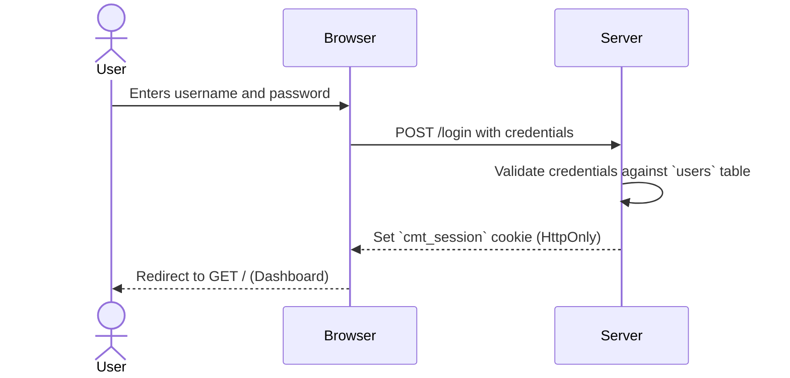
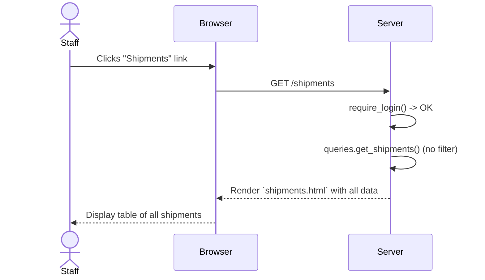
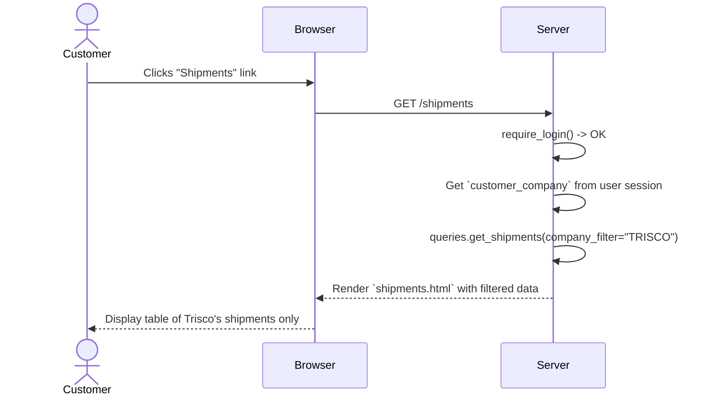

This file serves as a placeholder for a detailed User Flow diagram.

**Derives from**: `docs/information_architecture.md`

## User Flow: Successful Login

## User Flow: View Shipments (Staff)

## User Flow: View Shipments (Customer)

